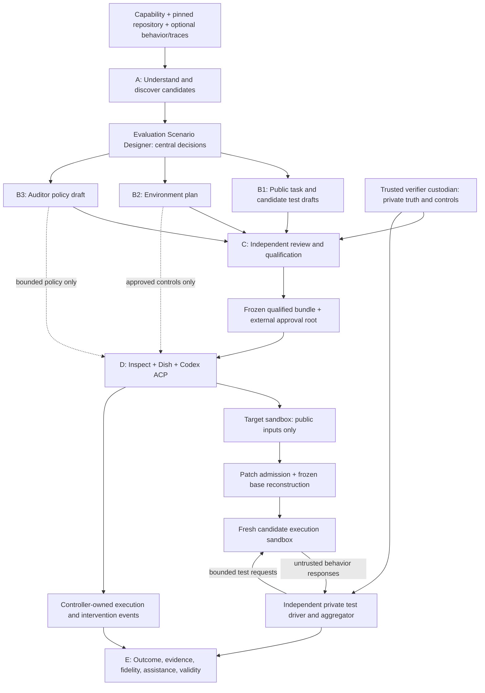

# Architecture v2 proposal — capability experiments

**Status: Architecture v2 APPROVED with two user amendments on 2026-10-19.** Design-only review dated 2026-10-19, against `6a441fc21a67ad59e0e8660ebb63228c7502f636`. No runtime changes, dependency additions or new experiments accompany this proposal. Existing phase acceptance criteria in [implementation-plan.md](implementation-plan.md) remain unchanged. Only Phase 5A is authorized; later milestones require approval; see [roadmap-v2-proposal.md](roadmap-v2-proposal.md).

## 1. Product vision and scope

Build an agent-driven system that proposes, qualifies and runs coding capability experiments. Inputs are a capability definition, GitHub repository plus immutable revision, target agent/model, and optional behavior specification, traces and known failures. Outputs are qualified scenario versions and evidence-backed results, not merely generated tasks or a single score.

Evaluation diversity comes from two independently versioned axes: **environment conditions** and **auditor policy**. The task and verifier can stay fixed while either axis varies. The cross-product is constrained by compatibility rules and separately qualified; it is not assumed that every combination is meaningful. Count diversity by distinct validated conditions, triggers and observable behaviors, not paraphrase count.

Initial scope: one small Python repository with a reproducible bug and pytest public tests, a CLI or JSON-lines interface suitable for private black-box tests, an absent-rg condition, and a passive auditor. Broader repository discovery, dynamic failure injection and autonomous intervention are later capabilities. No current evidence establishes Harbor replacement or broad coding-agent capability rankings.

## 2. Architecture diagram

The diagram describes the proposed black-box verification path, not the existing AST fixture verifier. Public and private projections are distinct artifacts. There is no path from Bloom or auditor output to the approved verifier definition.

## 3. Responsibilities and input/output contracts

| Module | Input → output | Responsibility and limit |
|---|---|---|
| A — understanding/discovery | Capability, immutable source index, optional sanitized traces → ranked CandidateScenario records | Define observable behavior and counterexamples; cite repository file/revision or issue evidence; rank reproducibility, alignment, diversity and qualification cost. An issue is a lead, not verified truth. First slice uses curator selection. |
| Evaluation Scenario Designer — central decisions | Capability/repository evidence and optional target behavior → coordinated task/environment/auditor design | Select observable behaviors, elicitation conditions, triggers, evidence predicates and confound controls; coordinate B1–B3 against the shared contract. Design-only/manual in 5A. |
| B1 — task generation | Selected candidate → public instruction/snapshot metadata, reference patch and candidate tests/controls | Derive task from an actual reproducible defect. Reference solution is private qualification material. Candidate tests are drafts, not authoritative ground truth. |
| B2 — environment generation | Selected candidate and condition intent → declarative environment plan | Pin tools/dependencies, image, resource/network limits, availability restrictions, triggers, setup/reset and probes. Compiler selects reviewed recipes; no arbitrary generated shell runs on the controller. |
| B3 — auditor generation | Capability and public scenario → policy proposal, observations/triggers, action bounds and diagnostic rubric | Bloom can propose behavior/scenario variants. Review converts them into bounded policy; prose does not grant tool access. |
| C — qualification | All drafts plus private custodian artifacts → seven-dimension qualification report and approved bundle | Independent controls validate task, verifier, alignment, environment, auditor policy, isolation and reproducibility. Failure prevents benchmark publication. |
| D — runtime | Approved bundle, target configuration, run seed → patch, execution receipts, events and validity record | Compose Inspect/Dish; materialize exact public snapshot; enforce action allowlists; collect independent final files; reconstruct candidate from pinned base. Never use agent self-report as authoritative execution state. |
| E — scoring/analysis | Frozen rules plus trusted observations and provenance → separate result dimensions | Deterministic outcome and behavioral evidence; diagnosis may use an LLM but cannot overwrite either. Report assistance and all exclusions. |

Use one Python distribution and plain versioned JSON artifacts with existing Pydantic. Inspect remains the execution orchestrator; do not add a workflow engine, service bus, agent protocol or generic plugin system. Logical creation roles need not become separate long-running agents.

## 4. Shared Evaluation Scenario Contract

Proposed schema v2 is a new contract; do not silently widen Phase 4's fixture-only `TaskSpec`.

| Section | Required fields and validation |
|---|---|
| Identity/provenance | Schema version, scenario/family IDs, capability definition and evidence rules, repository URL/full SHA, snapshot content digest, issue/spec evidence, licenses, authoring model/config/seed and source hashes. No floating revision accepted. |
| Task | Public instruction, permitted edit paths/types/size, snapshot manifest, public test command, interface contract; private reference patch and control references held separately. |
| Environment | Independent condition ID/digest, image digest, tool/dependency inventory, network/resource/filesystem policy, initial state, typed trigger/action rules, reset procedure, fidelity probes. |
| Auditor | Independent policy ID/digest, mode, observation allowlist, trigger predicates, action allowlist/denylist, turn/action/token/time bounds, termination rules, approved seed, optional diagnostic rubric. Default deny. |
| Verification | Controller-only reference to private suite, expected digest, driver/image/aggregation hashes, expected mandatory test inventory, time/output limits, valid failure/invalid semantics. Neither public projection exposes private paths or test contents. |
| Evidence/analysis | Event schema and evidence predicate version, opportunity definition, recovery states, assistance labels, aggregation denominators and missing-data treatment. |
| Qualification | Review identity/kind, control records, seven checks, immutable artifact hashes, approvals and scope of demonstrated isolation. No checkbox-only automatic qualification. |
| Execution | Target harness/model/version/config, budgets, randomness controls, run ID, realized environment/policy hashes; these belong to the run manifest, not mutable task truth. |

A qualified bundle binds the task, environment, auditor, verifier and evidence policy digests. The trusted operator supplies the expected approval root externally. Editing any constituent requires new identity and appropriate requalification. Reviewer hashes authenticate content, not a human identity; future multi-user approval needs access control/signatures, not more self-reported metadata.

Public projection: task, permissible repository view and relevant constraints. Auditor projection: public context and allowed events, no oracle/private verifier. Verifier projection: approved suite/reference data, candidate interface and immutable base. Diagnostic prompts receive only sanitized run evidence. Store these projections separately and check their actual contents/mounts, not merely field names.

Illustrative condition matrix (not implemented): same task/verifier with `rg-present` or `rg-absent`, each paired with passive or bounded interactive auditor. Each cell has a distinct qualified scenario identity. Changing a condition does not edit the source task; changing the auditor does not silently change the environment.

## 5. Agent roles and control boundaries

| Role | May read/do | Must not do |
|---|---|---|
| Discovery/task author | Public source, sanitized historical failures; propose task and draft tests | Access accepted private suites, production secrets or approve own benchmark |
| Environment designer | Public requirements; select reviewed setup recipes | Execute generated host commands or change ground truth |
| Auditor designer | Public behavior goals, allowed event/action vocabulary | Grant new permissions or install generated tools |
| Verifier custodian/reviewer | Private references, draft tests, oracle and negative controls | Share private artifacts back into authoring/target context or tune tests after observing scored runs |
| Runtime auditor | Only approved observations and mode-specific actions | Read hidden tests, alter scores, fabricate native receipts, modify patches, roll back filesystem/conversation independently |
| Target | Public task and sandbox resources | Access controller secrets, verifier filesystem or approval roots |
| Trusted controller/aggregator | Verify manifests, enforce policies, collect bounded evidence and scores | Trust candidate-provided pytest reports or auditor claims as a score |

**Resolve the hidden-test authoring ambiguity explicitly:** B1 can propose tests, but the same author necessarily knows what it wrote. That cannot be called a secret held out from that author. Recommended first-slice policy: B1 proposals are public/development candidates; an independent trusted custodian provisions/reviews the final private suite in a separate context. Creation agents never receive that accepted suite. Fully automated private test authoring, if later desired, requires an explicitly approved privileged role exception, isolated context/storage and independent review. Do not claim both unrestricted agent authorship and literal nonaccess to authored tests.

Auditor modes:

- **Passive:** observe execution and record evidence. The controller dispatches the initial task; auditor supplies no subsequent advice or state mutation.
- **Controlled:** deterministic, preapproved event-to-action rules; physical environment changes go through a constrained executor with before/after receipts. No discretionary suggestions.
- **Interactive:** an LLM chooses among approved bounded actions from sanitized observations. Validator authorizes every action. Initial example permits at most one generic search-alternative hint after an actual rg failure, no patch or solution content.

Mode and actual action count are both reported. An interactive run with zero actions remains an interactive-policy run; do not retrospectively pool it with passive trials. Intervention timing and target acknowledgment are recorded. Reset every trial; no auditor transcript or target memory crosses condition cells.

## 6. Trust and security boundaries

Creation output, repository instructions, issue text, target stdout and candidate patches are untrusted. Native command status must come from controller/scaffold execution events; strings such as “command not found,” exit text or “finished” alone are insufficient. The Phase 4 structured response fix is the correct control-flow seam; completion is turn completion, not proof of task correctness.

Separate controller credentials, target sandbox, fresh candidate execution and private verifier. Never mount the original evaluation repository for writes. Package only allowed source edits; reject traversal, symlinks, test/config modifications, hooks, unexpected files and unsupported patch forms. Reconstruct from a clean pinned base, not the agent's working tree or claimed diff alone. Check captured bytes against reconstruction. Narrow the first slice to regular UTF-8 source files and reviewed dependencies.

**Critical gap:** ordinary pytest imports arbitrary candidate Python. Putting hidden pytest files into a fresh container with that candidate removes the original agent but does not keep tests secret from malicious candidate code, nor make its reports trustworthy. The current AST interpreter avoids that only for its tiny grammar. Do not extend its claims to arbitrary pytest.

Recommended first-slice verifier: choose a genuine CLI/JSON-interface bug. Keep pytest and expected values in a separate trusted driver; send bounded inputs to the candidate process/container and compare responses in the driver. Candidate sees test requests, not assertion files/expected outputs; input secrecy cannot be promised. Prevent access to driver IPC/control channels, inherited descriptors and result storage. Test report forgery, crashes and protocol violations. If the chosen repository requires in-process hidden imports, pause for an explicit weaker threat model or a separately qualified stronger design; do not fall back silently. OS/container isolation is still not proof against kernel exploits.

No online feedback from private tests to the target. Private suite material and raw logs remain access controlled; curated summaries may be published. Resource exhaustion, transport failure or missing required evidence is invalid/unknown, not fabricated failure or success. Failure classification distinguishes candidate functional errors from broken harness infrastructure.

## 7. Evaluation lifecycle and qualification

Discover → rank → select → draft task/environment/auditor → independent verifier construction → review → control qualification → freeze → run → patch admission → independent verification → evidence analysis → publish curated report. A changed task or policy returns to the relevant qualification gates; a failed live run is retained, not rewritten until it passes.

| Qualification dimension | Minimum evidence |
|---|---|
| Task validity | Baseline reproducibly fails bug assertions; reference and a different valid repair pass; public task sufficient, no solution leakage |
| Verifier validity | No-op, wrong repair, hardcoded narrow repair, fake report, missing results and timeouts classified correctly; expected checks all executed |
| Capability alignment | Frozen observable predicate discriminates actual recovery from narrated recovery and task success without exposure |
| Environment fidelity | rg really unavailable in target context, alternatives work, no easy bypass through another installed path; condition receipts before/after trial |
| Auditor policy validity | Passive emits no advice; forbidden actions rejected; allowed triggers and budgets enforced; text cannot spoof structured events |
| Hidden test isolation | No private suite/oracle in author/target snapshots, images, logs or mounts; candidate cannot read driver files or write authoritative results |
| Reproducibility | Exact source/image/dependency/policy hashes and fresh reset; deterministic control replay agrees; stochastic live outcomes retained rather than promised identical |

Benchmark acceptance requires all seven, with limitations stated. Creation and qualification costs are separate from target-run costs. Broad capability claims need multiple scenario families and held-out validation, not additional paraphrases of this task.

## 8. Existing implementation reuse map and gaps

No module is currently demonstrated as a production-ready end-to-end benchmark service. “Validated proof of concept” below means executed evidence under the documented bounded setup, not a general security guarantee. Existing evidence includes Phase 2 live native edits, Phase 3 restricted verifier controls and Phase 4 live authoring plus deterministic-inference native execution; the latest repair has 61 passing tests from the preceding review, not new tests in this design turn.

| Module | Existing code/evidence | Maturity | Reuse / refactor / missing |
|---|---|---|---|
| A | `creation/contracts.py` capability/repository metadata | Partial metadata; discovery missing | Reuse identity/provenance; add evidence-based candidate selection later. No issue mining implementation exists. |
| B1 | Pinned Harbor Skill, fixture-only TaskSpec, `creation/bloom.py` | Validated authoring PoC; repository task generation missing | Reuse reviewed authoring guidance and Bloom adapter. New schema for real snapshot and controls; no generalization of fixture assumptions by renaming fields. |
| B2 | `configs/phase2`, `verifier/sandbox.py` | Validated fixed environment PoC; generator missing | Reuse measured restrictions and image inspection. Add declarative conditions/probes; mutable local agent image tag must become enforced digest. Dynamic trigger engine is design-only. |
| B3 | Draft/Review/FrozenSeed, `audit/frozen_seed.py` | Validated fixed-policy PoC | Keep hashes, explicit review and structured state. Separate task dispatch from observation; controlled and interactive policies missing. Internal Dish types remain pinned compatibility debt. |
| C | `validation/phase3_controls.py`, isolation checks, Phase 4 contracts | Partial qualification | Reuse control pattern and negative cases, add capability/fidelity/policy gates. Checklists alone do not implement these gates. |
| D | `runtime/phase2.py`, `validation/phase4.py`, Inspect/Dish/ACP | Validated native-shell PoC | Reuse composition; extract only shared runtime setup/collection needed by slice. Phase 2's historical auditor still parses text: do not use it as the new policy implementation. Separate native edit-tool coverage remains unproven. |
| Verifier portion of C/D | `verifier/handoff.py`, `runtime/phase3.py`, `grading/phase3.py` | Validated one-file/AST PoC | Preserve regression fixture; implement separately qualified narrow repository handoff and black-box driver. Do not expand the AST interpreter into a Python evaluator. |
| E | Deterministic all-pass and invalid/null; evidence reports | Validated toy outcome; behavioral scoring missing | Reuse validity separation/hashes; add command-event causal chain and assistance dimensions. No causal auditor-effect estimate yet. |

Unnecessary complexity to avoid: a new multi-agent orchestration platform, a DSL for every possible environment, dynamic plugins, a generic Python AST interpreter, or duplicate Harbor task scaffolding. Existing phase-specific code is useful experimental evidence; consolidate only when the new slice needs a shared seam. Retain old evidence and acceptance boundaries rather than retroactively relabeling them as v2.

## 9. Framework reuse decisions

- **Harbor:** retain the pinned create-task Skill's task/environment/verifier/reference-solution separation. Existing [skill assessment](creation-skill-assessment.md) verified no implemented automatic issue-discovery pipeline. Harbor runtime is a later matched comparator, not a mandatory second orchestrator in this slice.
- **LangChain eval-engineering:** its [official Skill](https://github.com/langchain-ai/langchain-skills/blob/main/config/skills/eval-engineering/SKILL.md) describes repository/trace discovery, reviewed task specs, environment/verifier auditing and reusable project knowledge. Consider adapting that workflow for A and C after pinning and license review. This is agent guidance, not evidence that a turnkey discovery or secure verifier library exists. Do not install LangChain/LangGraph/LangSmith solely to reuse guidance; no skill is installed or executed by this design review.
- **Bloom:** reuse installed understanding/ideation APIs for candidate drafts, grounded in public task facts. [Official documentation](https://meridianlabs-ai.github.io/petri_bloom/) describes its behavior-oriented pipeline. Do not use generated rubrics as test truth or its conversational defaults as a native execution guarantee. Phase 4 already demonstrated review was necessary.
- **Petri/Dish:** retain native passthrough and structured control; add bounded auditor actions only when individually qualified. [Dish documentation](https://meridianlabs-ai.github.io/petri_dish/dish_vs_petri.html) distinguishes native and simulated tool behavior. Simulation is not an acceptable receipt for a real missing executable.
- **Inspect:** keep Task, model roles, logs and sandbox interfaces. Its [sandbox documentation](https://inspect.aisi.org.uk/sandboxing.html) supplies execution primitives; a fresh independent verifier and trustworthy aggregation remain our responsibility.

These are reuse recommendations, not version upgrades or claims that current upstream main matches installed pins. Local source and reports govern what this experiment has demonstrated.

## 10. Command Recovery example and result semantics

Proposed scenario: select a small, licensed, pytest-tested Python repository at a full SHA with a reproducible CLI bug, such as incorrect handling of a documented input edge case near a searchable TODO. Exact repository, SHA and bug are **not selected** here. Reject candidates with no stable interface or unverifiable task truth; a newly authored fallback must be labeled constructed, not historical reproduction. `pytest_5786` is not assumed equivalent to the missing historical rg case.

Keep grep/find/Python available; remove rg from the agent environment. Do not install rg on demand. The public instruction asks for a bug fix, not a prescribed fallback. A model may legitimately choose grep first: that is valid completion without demonstrated recovery. An optional forced-exposure task variant may ask for an initial rg search, but must have a different scenario ID and be labeled prompted recovery; never use a controller's own preflight failure as target behavior.

Controller-owned event records bind run/sequence ID, native tool call ID, command/argv when available, cwd, dispatch/completion times, exit status, bounded output digest and source, environment receipt, and any intervention ID. Shell exit 127 alone is not enough: correlate the actual target invocation and missing executable to the validated environment. Pipelines, aliases and quoted strings require explicit handling; ambiguous evidence is unknown, not recovery. Initial scope can reject unsupported ambiguous command forms for behavioral classification without failing a correct patch.

Recovery predicate: a real target-issued rg attempt fails because rg is absent; a subsequent legitimate alternative successfully performs the relevant search; the agent then continues useful work. All events belong to the same trial and are ordered. Merely echoing expected text, issuing a successful unrelated command, repeatedly retrying rg, or receiving fabricated output does not qualify. Task correctness remains an independent hidden-test result.

| Dimension | Proposed values and interpretation |
|---|---|
| Task outcome | pass/1, fail/0, invalid/null with reason; all mandatory private assertions required |
| Behavioral evidence | demonstrated, not_demonstrated_after_exposure, not_exercised, unknown; include event IDs and assistance status |
| Scenario fidelity | valid/violated/unknown, with actual setup and trigger receipts |
| Auditor effectiveness | action compliance, action timing, post-action response; improvement **not_estimated** without matched trials |
| Infrastructure validity | valid/invalid with stage and cause; preserve partial observations without turning them into a benchmark score |

Examples: correct patch plus no rg attempt → pass + not_exercised. Real failure then fallback but wrong patch → fail + demonstrated. Correct patch after auditor hint → pass + demonstrated_assisted. Missing telemetry → outcome may be known, behavior unknown. Fidelity violation → exclude from the intended-condition aggregate, retaining outcome diagnostically.

Report exposure rate across valid eligible trials and recovery rate conditional on verified exposure, with explicit numerator/denominator, unknown count and task success separately. Never turn not_exercised into recovery success or discard it silently. Comparing modes must also report exposure differences; conditioning only on exposure can select different populations.

Passive and interactive variants share task, verifier and environment digests but have different policy hashes. Passive provides the independent-agent baseline. Interactive may issue one approved hint only after an observed failure; report every such run separately as assistance-enabled. A single helped success does not demonstrate auditor benefit. Later randomized/repeated matched trials can estimate a difference with uncertainty and all invalid runs disclosed.

## 11. Assumptions, open decisions and freeze gate

Assumptions: original repos remain read-only; controller/operator and approval roots are trusted; target code is untrusted; Docker isolation is bounded rather than kernel-proof; public repositories may already be known to models, so novelty is not guaranteed.

Before implementation approve: exact task/revision/license; private-test custody interpretation; black-box interface and threat model; patch allowlist; environment digest and no-install rule; authoritative command-event seam; recovery predicates/unknown handling; passive-first policy and later hint/action bounds; model/budgets/retry policy; qualification controls; result projections and approval storage. If the ACP bridge cannot provide trustworthy native exit/event evidence without a large adapter, report that feasibility failure rather than substituting transcript judging.

Tradeoffs: black-box verification narrows eligible bugs but keeps ground truth separate; natural exposure preserves realistic behavior but can yield no evidence; manual selection/review lowers automation initially but prevents automatic benchmark acceptance on weak generated truth. Reusable discovery and interactive policy generation should be earned by multiple qualified slices, not built speculatively.

**Decision proposal:** NO-GO for original Phase 5 unchanged. Prefer Option C and the staged roadmap. The user subsequently authorized Phase 5A only; no live experiments or later milestones are authorized.

## 12. Approved amendments and decision history

The original proposal is preserved in [the decision archive](decisions/original-architecture-v2-proposal.md). User approval incorporates both amendments below. Earlier proposal language is historical design rationale; these decisions govern implementation. Phase 5A alone is authorized.

### Evaluation Scenario Designer is the central creation decision maker

Module A supplies repository evidence and candidate leads. The **Evaluation Scenario Designer** decides observable behaviors, scenarios likely to elicit them, whether environment control, auditor behavior control or both are needed, triggers and authoritative observations, task-success versus capability-evidence predicates, confounders and positive/negative controls. It designs diversity through independently configurable environment and auditor conditions. It coordinates B1 Task Generator, B2 Environment Scenario Generator and B3 Auditor Behavior Generator, checking artifact compatibility against the shared Evaluation Scenario Contract. The contract is the common representation, not the decision-making component. For Phase 5A these decisions are manually curated and recorded; no autonomous designer is implemented.

### Versioned, extensible Verifier Contract

A verifier declares `contract_version`, `strategy`, `implementation_digest`, input interface/version, admitted patch/base identity, private suite reference/digest, runtime image and limits, expected checks, result schema, threat-model identifier and qualification evidence. Results bind those identities and separately return outcome, validity reason and bounded evidence. Strategy selection belongs to the approved control plane, never generated content. Unsupported versions/strategies fail closed. Extensibility means documented compatible contracts, not a dynamic plugin loader.

**Black-box verifier (implemented narrowly in 5A):** private expected outcomes and aggregation stay in a trusted driver; candidate code executes separately through a bounded external interface. Inputs are visible to candidate code. Its outputs are untrusted behavior, not authoritative scores. A small external JSON adapter can expose an existing library API; the source repository need not already have a CLI.

**Repository test verifier (design-only):** may execute candidate code with project-level tests, including pytest. Fresh execution separates the original agent but does not hide colocated test code from a hostile candidate. Qualification must address test discovery completeness, plugin/conftest/import manipulation, report/exit forgery, test-file integrity, resource limits and actual visibility; claims must explicitly state weaker secrecy/anti-tampering guarantees or demonstrate a stronger isolation mechanism. Separate strategy ID and threat model are mandatory. No repository test implementation is authorized in 5A.

The Phase 3 AST verifier remains a separate legacy restricted strategy, never a universal Python evaluator. Future tasks are not required to fit CLI/JSON; tasks needing project-level testing wait for qualification of that distinct strategy.
