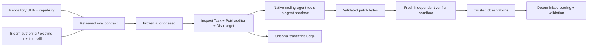

# Proposed minimal architecture

Status: design only; no runtime integration implemented.

Use one Python distribution, one composed Inspect task, and one independent verifier launcher. No service, new agent protocol, generic plugin framework, or upstream fork is required by this design.

| Reserved module | Future responsibility | Minimum interface |
|---|---|---|
| `creation` | Consume existing Skill output or reviewed Bloom output | Frozen repository SHA, capability, public task payload and private verification reference |
| `audit` | Translate reviewed contract to seed and constrain auditor | Seed identity/hash and permitted interventions; no private test information |
| `runtime` | Compose public Dish/Petri/Inspect APIs and export patch | Run identity, pinned scaffold/image, tool evidence, final source diff |
| `verifier` | Validate patch, reconstruct frozen base, launch isolated checks | Patch bytes in; trusted, complete check observations out |
| `grading` | Preserve deterministic outcome and invalid-run semantics | Mandatory all-pass, diagnostics separately, infrastructure/submission statuses |
| `validation` | Controls, provenance and comparison reports | Exact inputs, hashes, control outcomes and evidence inventory |

The first runtime experiment uses a reviewed seed and native passthrough tools; Bloom generation is added after that path is proven. Each run has a fresh agent sandbox and a separate verifier sandbox. Only validated source changes cross the boundary. Tests and secrets live in a provisioned ignored private area or protected store, never in committed source or the agent image. Curated non-sensitive result summaries can be committed after review.

Freeze repository, dependencies, agent CLI/ACP driver, images by digest, prompt/seed, budgets and scorer version. The controller may access model services; sandbox egress and credential delivery must be explicitly validated. Credentials must not enter source snapshots or verifier workers.

Disable auditor rollback/restart initially and restrict environmental rewriting. A later design enabling branching must pair conversation branches with filesystem snapshots and prove consistency. Native tool execution receipts and file hashes are evidence; auditor-generated claims are not.

Keep the existing grader's outcome semantics when reusing `pytest_5786`: all mandatory checks pass; diagnostic failures do not alter the main outcome; malformed or incomplete execution is never a valid success. The new command-recovery scenario gets its own contract and controls, and is not assigned the old task's identity.
